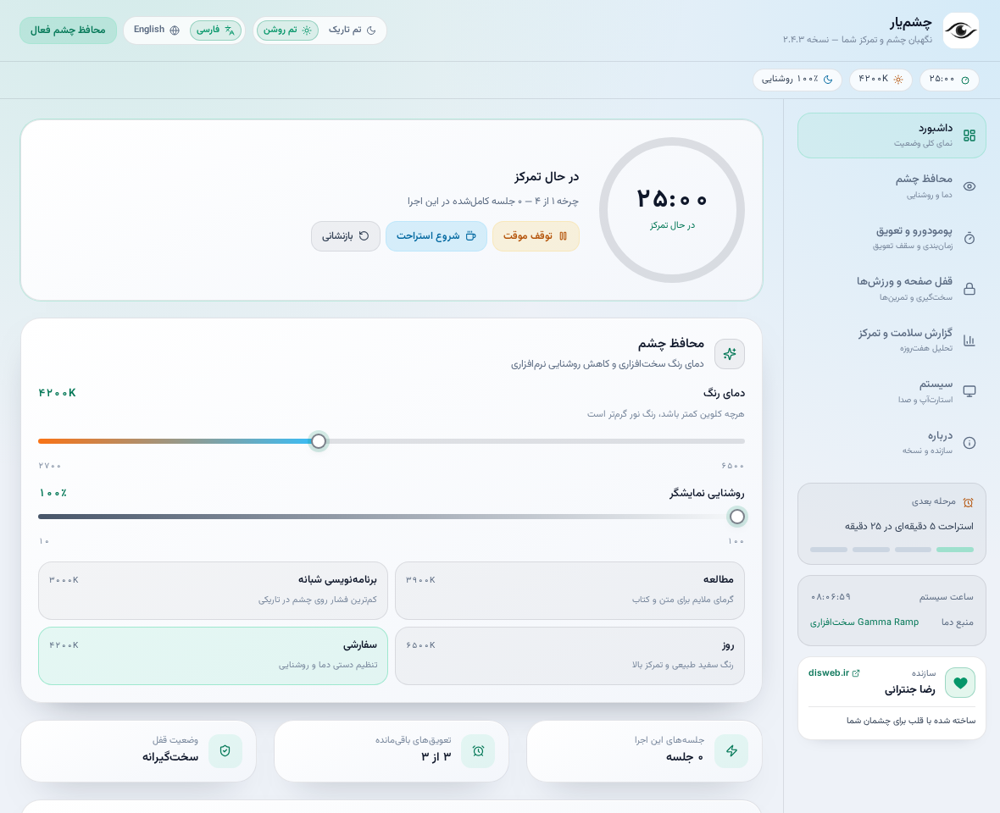
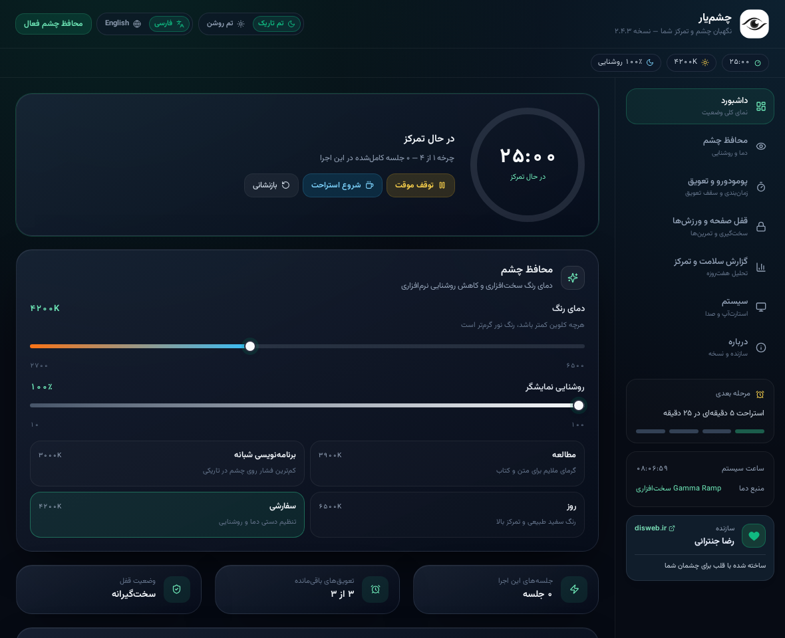

<div align="center">
  
  <h1>ChashmYar | چشم‌یار</h1>
  <p><strong>A Windows companion for breaks, eye-care reminders and focus</strong></p>
  <p>Windows x64 · Tauri 2 · Rust · React · TypeScript</p>
  <p><a href="README.md">فارسی</a> · <a href="docs/USER_GUIDE_FA.md">User guide (Persian)</a> · <a href="docs/DEVELOPMENT.md">Development</a> · <a href="docs/CI_AND_RELEASE.md">CI and release</a></p>
</div>

ChashmYar schedules work and breaks, offers short exercises, and provides display color-temperature and software-brightness controls. The UI supports Persian and English and light and dark themes.



<details>
<summary>Dark theme</summary>



</details>

Screenshots show the browser mock with sample data; they are not evidence of native Windows behavior. The version displayed is the source baseline, not necessarily the latest release.

## Download and requirements

Open the repository's **Releases** page and choose a published version. If the page is empty, the repository owner has not published one yet.

| Release asset | Purpose |
|---|---|
| `ChashmYar_<version>_x64-setup.exe` | Per-user Windows installer |
| `ChashmYar-<version>-portable.exe` | Direct launch without installing the app |
| `SHA256SUMS.txt` | SHA-256 hashes for the release assets |
| `LICENSE`, `THIRD_PARTY_NOTICES.txt` | Project license and third-party notices |

The intended target is **Windows 10/11 x64** with [Microsoft Edge WebView2 Runtime](https://developer.microsoft.com/en-us/microsoft-edge/webview2/). The installer can download WebView2 if it is missing, requiring internet; portable use also requires the Runtime. Portable settings and analytics are stored in the user's app-data directory, not next to the executable.

Compare a downloaded file's hash against the matching line in the same Release, replacing the example version:

```powershell
Get-FileHash .\ChashmYar_2.4.4_x64-setup.exe -Algorithm SHA256
Get-Content .\SHA256SUMS.txt
```

A hash checks consistency with that manifest, **not publisher identity**. Default builds are unsigned and may trigger SmartScreen. Download from a trusted source and follow your organization's security policy.

## Features and defaults

- Work/break timer, start/pause, snooze, short exercises, break guidance and a floating/docked timer widget.
- Color temperature, software brightness, a night schedule and a color-safe application list.
- Two explainable indicators based on recorded timer outcomes; no invented score when there is insufficient data.
- Fresh installs request Windows autostart after the first launch and enable automatic timer start, the night schedule and exercises. These options are configurable and previously stored choices are retained.
- Alert, short-exercise, break and penalty sounds are **off** on fresh installs. Enable them in System → Play alert sounds. Visual notifications remain enabled; an explicitly stored previous sound preference is preserved.
- Bilingual UI, local settings and analytics, light/dark appearance and system tray controls.

**Safety and limitations:** This is not a medical device; scores do not establish eye health, concentration or exercise completion. Gamma depends on hardware, drivers and HDR, and resetting it may not restore a previous custom calibration. Software brightness uses an overlay: capture exclusion and eliminating every popup flash cannot be guaranteed. Test the behavior on your own device.

When enabled, emergency exit during a strict break requires holding **Ctrl and Shift** together for the configured duration; U is not needed. Save work and test strict mode in a safe environment first. An ordinary Windows app cannot block Ctrl+Alt+Del. See the [user guide](docs/USER_GUIDE_FA.md) for details.

## For repository owners: build with GitHub

**This is source code; no newly built executable is included.** Each push to `main` requests an automatic patch release: the workflow allocates a version, builds Windows x64 and, if its checks pass, **publishes a Release without manual approval**. The separate `CI` workflow also runs, but its result is not a dependency of the release workflow.

The source baseline is `2.4.3`; in a new repository without higher stable tags, the first successful release is normally `v2.4.4`. Older 2.4.3 executables do not contain the new logo. GitHub execution and real Windows behavior have not yet been confirmed for this source in your repository. Permissions, failed checks and queue limits can prevent publication.

Read [CI and release](docs/CI_AND_RELEASE.md) for exact setup, artifacts and recovery. The [Persian GitHub quickstart](docs/GITHUB_QUICKSTART_FA.md) walks through the first upload. Do not omit `.github`, lockfiles, tests or the vendored Tao patch.

## Data and privacy

Settings and analytics are normally stored in `%APPDATA%\com.chashmyar.desktop\`; diagnostics are normally in `%LOCALAPPDATA%\ChashmYar\startup.log`. Stop the app before backing up its data, and review logs for personal paths before sharing. The current code has no remote analytics-upload service. The color-safe watcher reads active process names and window titles locally; the separate overlay listener reacts to event types and window handles without reading titles or keystrokes. The creator link opens the system browser; the installer can download WebView2. See [architecture and data](docs/ARCHITECTURE.md).

## Development and documentation

Windows development requires Node.js, Rust/MSVC, the C++ tools and WebView2. They are **not** required locally just to push this source for GitHub to build. See [development and tests](docs/DEVELOPMENT.md), [architecture](docs/ARCHITECTURE.md), [branding](assets/branding/README.md), [changelog](CHANGELOG.md), [contributing](CONTRIBUTING.md) and [security](SECURITY.md).

The project's source is [MIT licensed](LICENSE); third-party components retain their own licenses: [notices](THIRD_PARTY_NOTICES.txt). Created by Reza Jantrani — [disweb.ir](https://disweb.ir/).
