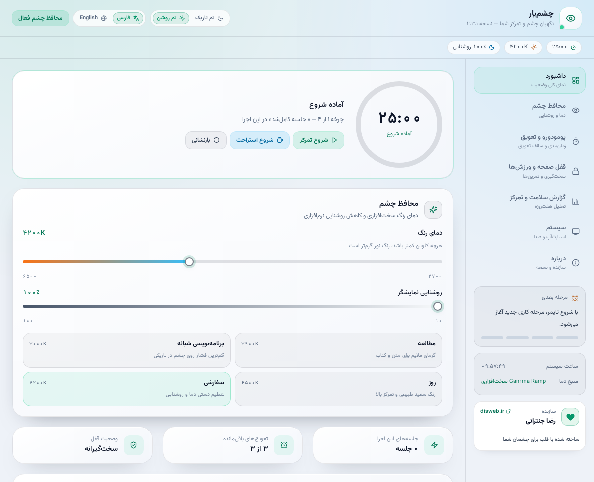
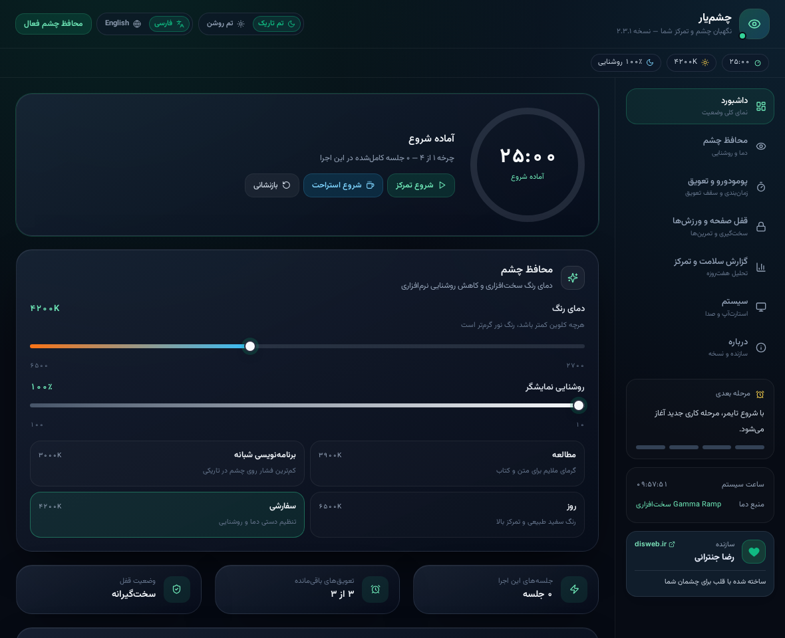

<div align="center">
  
  <h1>چشم‌یار | ChashmYar</h1>
  <p><strong>یادآور استراحت، مراقبت از چشم و همراه تمرکز برای ویندوز</strong></p>
  <p>React · TypeScript · Tauri 2 · Rust · Windows x64</p>
  <p><a href="README.en.md">English</a> · <a href="docs/USER_GUIDE_FA.md">راهنمای کاربر</a> · <a href="docs/RELEASE_GUIDE_FA.md">راهنمای انتشار</a> · <a href="LICENSE">MIT</a></p>
</div>

چشم‌یار زمان کار و استراحت را مدیریت می‌کند، یادآور تمرین‌های کوتاه است و ابزارهایی برای تنظیم دمای رنگ و روشنایی صفحه دارد. رابط برنامه فارسی و انگلیسی است و با تم روشن و تاریک کار می‌کند.



<details>
<summary>نمای تم تاریک</summary>



</details>

تصاویر از پیش‌نمایش مرورگری با داده‌های نمونه گرفته شده‌اند؛ امکانات بومی مانند قلاب صفحه‌کلید و گاما در مرورگر اجرا نمی‌شوند.

## دانلود و نصب

در صفحهٔ مخزن GitHub وارد بخش **Releases** شوید و آخرین نسخهٔ منتشرشده را باز کنید. اگر Releases خالی است، هنوز نسخه‌ای توسط نگهدارنده منتشر نشده است.

| فایل انتشار | کاربرد |
|---|---|
| `ChashmYar_<version>_x64-setup.exe` | نصب‌کننده برای حساب ویندوز جاری |
| `ChashmYar-<version>-portable.exe` | اجرای مستقیم بدون نصب خود برنامه |
| `SHA256SUMS.txt` | هش SHA-256 فایل‌های انتشار برای بررسی صحت دانلود |
| `LICENSE` و `THIRD_PARTY_NOTICES.txt` | مجوز پروژه و اعلان مجوز وابستگی‌ها |

هدف انتشار، **ویندوز ۱۰/۱۱، معماری x64 و Microsoft Edge WebView2 Runtime** است. نصب‌کننده، اگر WebView2 موجود نباشد، برای دریافت آن به اینترنت نیاز دارد؛ نسخهٔ پرتابل نیز به WebView2 نیاز دارد. پرتابل تنظیمات و گزارش را در داده‌های کاربر ذخیره می‌کند، نه کنار فایل اجرایی. [دریافت رسمی WebView2](https://developer.microsoft.com/en-us/microsoft-edge/webview2/)

> فایل‌های ساخته‌شده در گردش پیش‌فرض **امضای دیجیتال ندارند** و ممکن است Windows SmartScreen هشدار دهد. از صفحهٔ Releases مورد اعتماد دانلود کنید و هش را تطبیق دهید. امضای کد، اگر خواسته شود، باید جداگانه با گواهی معتبر تنظیم شود.

## قابلیت‌ها

- زمان‌بندی کار و استراحت، شروع/مکث، تعویق و «تمرین کوتاه در حین کار».
- استراحت معمولی یا سخت‌گیرانه، راهنماهای تصویری چشم و بدن، و ابزارک شناور یا چسبیده به لبهٔ صفحه.
- کنترل دمای رنگ سخت‌افزاری و کاهش نور نرم‌افزاری؛ فهرست برنامه‌های حساس به رنگ و برنامه‌ریزی زمانی.
- دو شاخص شفاف برای پیامدهای ثبت‌شدهٔ استراحت‌ها و نظم نوبت‌های کاری؛ بدون امتیاز ساختگی برای دادهٔ ناکافی.
- فارسی و انگلیسی، رقم و قلم مناسب هر زبان، تم روشن و تاریک، منوی سینی سیستم و ذخیرهٔ تنظیمات.

**ایمنی:** این برنامه ابزار پزشکی یا تشخیصی نیست؛ شاخص‌ها رفتار واقعی یا سلامت چشم را اندازه‌گیری نمی‌کنند. در صورت درد یا ناراحتی تمرین را متوقف کنید. اثر گاما به نمایشگر، HDR، درایور و تنظیمات سیستم وابسته است؛ بازنشانی لزوماً کالیبراسیون سفارشی قبلی را برنمی‌گرداند. ویندوز به برنامهٔ معمولی اجازهٔ مسدودسازی Ctrl+Alt+Del را نمی‌دهد.

اگر خروج اضطراری در تنظیمات فعال باشد، در صفحهٔ استراحت **Ctrl و Shift را هم‌زمان به مدت تنظیم‌شده نگه دارید**؛ نیازی به U نیست. قبل از استفاده از قفل سخت‌گیرانه، آن را روی دستگاه امن و بدون کار ذخیره‌نشده امتحان کنید.

## داده‌ها و حریم خصوصی

تنظیمات و آمار از طریق ذخیره‌سازی محلی برنامه نگه‌داری می‌شوند؛ برنامه سرویس ارسال آمار به سرور در کد فعلی ندارد. برای فهرست برنامه‌های رنگ‌ایمن، نام پردازش و عنوان پنجرهٔ فعال در دستگاه بررسی می‌شوند. بازکردن سایت سازنده از مرورگر سیستم استفاده می‌کند و نصب‌کننده ممکن است WebView2 را دریافت کند.

به‌طور معمول داده‌ها در `%APPDATA%\com.chashmyar.desktop\` و گزارش اجرا در `%LOCALAPPDATA%\ChashmYar\startup.log` قرار دارند. پیش از به‌روزرسانی، برنامه را ببندید و از پوشهٔ داده پشتیبان بگیرید؛ قبل از ارسال لاگ، مسیرها و اطلاعات شخصی را بررسی کنید. جزئیات: [راهنمای کاربر](docs/USER_GUIDE_FA.md).

## توسعه و ساخت

پیش‌نیاز توسعهٔ ویندوز: Node.js 24 LTS، Rust stable با ابزار MSVC، «Desktop development with C++» و WebView2. جزئیات و لینک‌های رسمی در [راهنمای توسعه](docs/DEVELOPMENT.md) آمده است.

```powershell
npm ci
npm run version:check
npm run build:win
npm run verify:exe
```

خروجی محلی در `release/windows/` ساخته می‌شود؛ این پوشه و فایل‌های وابستگی/ساخت در Git ثبت نمی‌شوند. برای تهیهٔ دارایی‌های انتشار و هش‌ها:

```powershell
npm run licenses:generate
npm run release:stage
```

برای آزمون‌ها:

```powershell
npm run test:logic
npm run test:compat
npm run test:release
npm run build
npx playwright install chromium
npm run test:ui:all
```

آزمون‌های مرورگری IPC را شبیه‌سازی می‌کنند. **ساخت و آزمون واقعی نصب، ویجت، گاما، قفل و قلاب کیبورد روی ویندوز واقعی همچنان ضروری است.** فایل‌های نسخهٔ ۲.۳.۱ که پیش‌تر به‌صورت متقاطع در لینوکس ساخته شده‌اند، در محیط واقعی ویندوز آزمایش نشده‌اند.

## انتشار در GitHub

پروژه برای GitHub Actions آماده است. بعد از ثبت سورس، تگ پایدار مطابق نسخه، مثل `v2.3.1`، باعث ساخت فایل‌های ویندوز و ایجاد **Release پیش‌نویس** می‌شود؛ تا زمانی که نگهدارنده آن را بررسی و Publish نکند عمومی نخواهد شد. این گردش GitHub در این مخزن هنوز اجرا نشده و اولین اجرا باید بررسی شود.

**برای ساخت مخزن، انتشار اولین نسخه، افزایش شمارهٔ نسخه، بازبینی و رفع خطا، [راهنمای کامل فارسی انتشار](docs/RELEASE_GUIDE_FA.md) را بخوانید.**

## مستندات و همکاری

- [راهنمای کاربر](docs/USER_GUIDE_FA.md) · [معماری، داده‌ها و امتیازها](docs/ARCHITECTURE.md) · [توسعه و آزمون](docs/DEVELOPMENT.md)
- [تاریخچهٔ تغییرات](CHANGELOG.md) · [راهنمای مشارکت](CONTRIBUTING.md) · [امنیت](SECURITY.md) · [اصول جامعه](CODE_OF_CONDUCT.md)
- سورس پروژه تحت [MIT](LICENSE) منتشر می‌شود؛ قلم‌ها و سایر اجزای شخص ثالث مجوز خودشان را دارند: [اعلان‌ها](THIRD_PARTY_NOTICES.txt).

ساختهٔ **رضا جنترانی** — [disweb.ir](https://disweb.ir/) · ساخته شده با قلب برای چشمان شما.
