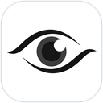
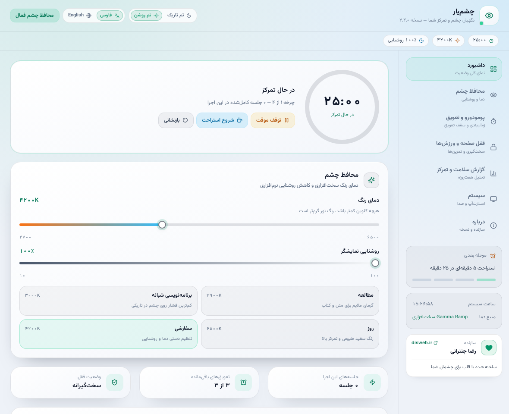
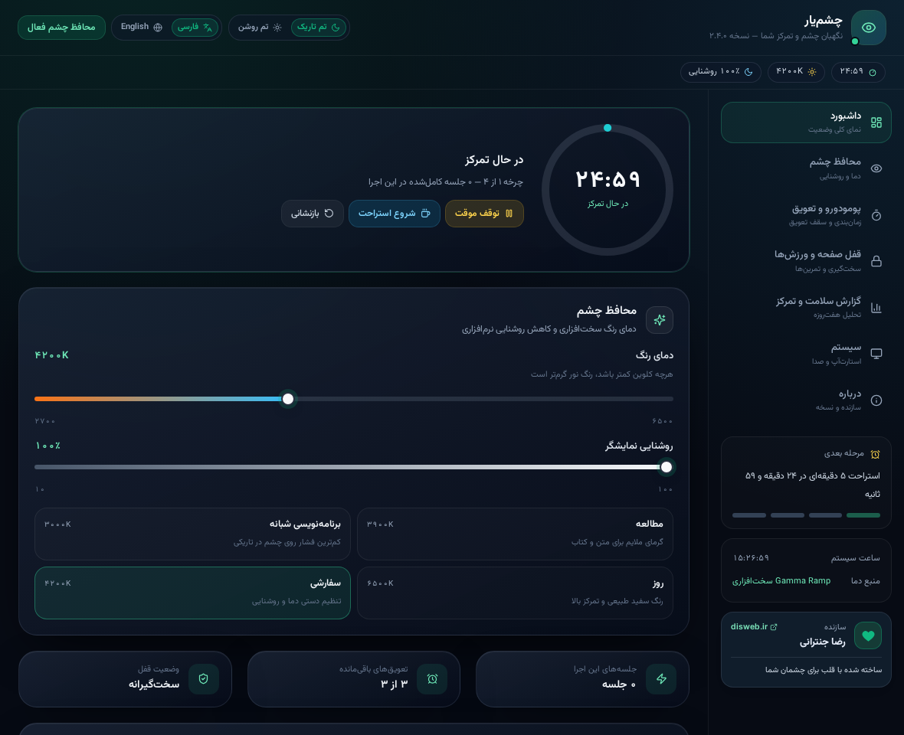

<div align="center">
  
  <h1>چشم‌یار | ChashmYar</h1>
  <p><strong>همراه استراحت، مراقبت از چشم و تمرکز برای ویندوز</strong></p>
  <p>Windows x64 · Tauri 2 · Rust · React · TypeScript</p>
  <p><a href="README.en.md">English</a> · <a href="docs/USER_GUIDE_FA.md">راهنمای کاربر</a> · <a href="docs/GITHUB_QUICKSTART_FA.md">شروع GitHub</a> · <a href="LICENSE">MIT</a></p>
</div>

چشم‌یار زمان کار و استراحت را مدیریت می‌کند، تمرین‌های کوتاه را یادآوری می‌کند و ابزارهایی برای تنظیم دمای رنگ و کاهش نور صفحه دارد. رابط کاربری فارسی و انگلیسی و تم روشن و تاریک دارد.



<details>
<summary>دیدن تم تاریک</summary>



</details>

این تصاویر از پیش‌نمایش مرورگر با دادهٔ نمونه‌اند؛ مرورگر عملکرد بومی ویندوز، گاما، قفل و سینی سیستم را اجرا نمی‌کند. شمارهٔ تصویر مربوط به زمان ثبت آن است و ممکن است با نسخهٔ فعلی یا آخرین انتشار متفاوت باشد.

## برای استفاده‌کنندگان: دانلود و نصب

در صفحهٔ مخزن GitHub، بخش **Releases** را باز و آخرین نسخهٔ منتشرشده را انتخاب کنید. اگر Releases خالی است، هنوز نسخه‌ای در آن مخزن منتشر نشده است.

| دارایی انتشار | کاربرد |
|---|---|
| `ChashmYar_<version>_x64-setup.exe` | نصب برنامه برای حساب ویندوز فعلی |
| `ChashmYar-<version>-portable.exe` | اجرای برنامه بدون نصب خود برنامه |
| دو فایل `*.exe.sig` و `latest.json` | امضاها و اطلاعات لازم برای به‌روزرسان امضاشده |
| `SHA256SUMS.txt` | هش فایل‌های همان انتشار برای بررسی سلامت دانلود |
| `LICENSE` و `THIRD_PARTY_NOTICES.txt` | مجوز پروژه و اعلان مجوز وابستگی‌ها |

هدف، **ویندوز ۱۰/۱۱ با معماری x64** و [Microsoft Edge WebView2 Runtime](https://developer.microsoft.com/en-us/microsoft-edge/webview2/) است. نصب‌کننده در صورت نبود WebView2 ممکن است برای دریافت آن اینترنت بخواهد؛ نسخهٔ پرتابل هم به Runtime نیاز دارد و تنظیمات را کنار فایل اجرایی ذخیره نمی‌کند. روش نصب، پشتیبان و عیب‌یابی در [راهنمای کاربر](docs/USER_GUIDE_FA.md) آمده است.

برای مقایسهٔ هش در PowerShell، شمارهٔ نسخه را با فایل واقعی جایگزین کنید:

```powershell
Get-FileHash .\ChashmYar_2.4.10_x64-setup.exe -Algorithm SHA256
Get-Content .\SHA256SUMS.txt
```

هش محاسبه‌شده را با خط مربوط در فایل همان Release مقایسه کنید. هش فقط سلامت فایل را نسبت به آن فهرست بررسی می‌کند و **هویت ناشر را تأیید نمی‌کند**. امضای updater با گواهی ناشر ویندوز (Authenticode) تفاوت دارد؛ بدون گواهی جداگانه ممکن است SmartScreen هشدار دهد. از منبع مورد اعتماد دانلود کنید.

## قابلیت‌ها و پیش‌فرض‌ها

- تایمر کار و استراحت، شروع/مکث، تعویق، تمرین کوتاه و ابزارک شناور یا چسبیده به لبهٔ صفحه.
- استراحت معمولی یا سخت‌گیرانه همراه راهنماهای تصویری چشم و بدن؛ گزارش‌های مبتنی بر رویداد تایمر.
- دمای رنگ سخت‌افزاری و کاهش نور نرم‌افزاری، زمان‌بندی شب و فهرست برنامه‌های حساس به رنگ.
- کمک آزمایشی دید رنگی تمام‌صفحه با پروفایل‌های دوتان، پروتان و تریتان و شدت قابل تنظیم؛ پیش‌فرض خاموش. این یک باز‌رنگ‌آمیزی تقریبی است، نه درمان یا تضمین بهبود؛ [راهنمای استفاده و محدودیت‌ها](docs/COLOR_VISION_FA.md).
- در نصب تازه، اجرای همراه ویندوز بعد از اولین اجرا، شروع خودکار تایمر، زمان‌بندی شب و تمرین‌ها روشن‌اند؛ از تنظیمات قابل تغییرند. انتخاب‌های ذخیره‌شدهٔ قبلی حفظ می‌شوند.
- صدای اعلان، تمرین کوتاه، استراحت و جریمه در نصب تازه **خاموش** است. برای فعال‌کردن آن به «سیستم ← صدا و رفتار پنجره ← پخش صدای هشدار» بروید. اعلان تصویری برقرار می‌ماند و انتخاب ذخیره‌شدهٔ قبلی صدا حفظ می‌شود.
- بررسی و دانلود خودکار نسخهٔ جدید از `diswebir/chashmyar` با تأیید امضا؛ نصب و اجرای مجدد فقط پس از تأیید شما، هم برای نسخهٔ نصبی و هم پرتابل. نسخه‌های قدیمی بدون updater ابتدا به ارتقای دستی نیاز دارند.
- تنظیمات و گزارش‌ها به‌صورت محلی ذخیره می‌شوند؛ سینی سیستم، زبان فارسی/انگلیسی و تم روشن/تاریک در دسترس‌اند.

**محدودیت‌های مهم:** چشم‌یار ابزار پزشکی یا تشخیصی نیست و شاخص‌ها سلامت چشم، تمرکز واقعی یا انجام تمرین را ثابت نمی‌کنند. دما و گاما به سخت‌افزار، درایور و HDR وابسته‌اند و بازنشانی لزوماً کالیبراسیون قبلی را برنمی‌گرداند. روشنایی پیش‌فرض از لایه استفاده می‌کند؛ حالت تمام‌صفحهٔ اختیاری رفتار ضبط متفاوتی دارد و ممکن است با Magnifier یا فیلترهای دیگر تداخل کند. پوشش همهٔ منوها، دیده‌نشدن در همهٔ روش‌های ضبط و حذف فلش تضمین نمی‌شود. عملکرد و بازگردانی این نسخه باید روی ویندوز واقعی آزموده شود.

اگر خروج اضطراری فعال باشد، در صفحهٔ استراحت **Ctrl و Shift را هم‌زمان برای مدت تنظیم‌شده نگه دارید**؛ کلید U لازم نیست. قبل از آزمایش قفل، کارها را ذخیره و در محیط امن امتحان کنید. برنامهٔ عادی ویندوز نمی‌تواند Ctrl+Alt+Del را مسدود کند. جزئیات: [راهنمای کاربر](docs/USER_GUIDE_FA.md).

## برای صاحب مخزن: ساخت با GitHub Actions

**این بسته سورس است و فایل اجرایی جدید همراه آن نیست.** پیش از push، همان کلید امضای انتشارهای قبلی را طبق [راهنمای ثبت کلید در GitHub](docs/UPDATER_SIGNING_FA.md) حفظ کنید؛ بدون آن انتشار متوقف می‌شود. پس از انتقال کامل سورس، هر push به `main` یک اجرای انتشار درخواست می‌کند: نسخهٔ Patch تخصیص داده می‌شود، ویندوز x64 روی runner ساخته می‌شود و در صورت موفقیت کنترل‌ها، Release **بدون تأیید دستی** منتشر می‌شود. گردش جداگانهٔ `CI` نیز اجرا می‌شود، اما گردش انتشار منتظر نتیجهٔ آن گردش جداگانه نمی‌ماند.

نسخهٔ پایهٔ این سورس `2.4.10` است. اگر بیشترین تگ پایدار `v2.4.9` باشد، انتشار بعدی `v2.4.10` می‌شود؛ تگ برابر یا بالاتر باعث انتخاب Patch بعد از بزرگ‌ترین تگ می‌شود، نه بازنویسی آن. هاور دوثانیه‌ای ویجت چسبیده حفظ شده است. محافظ ترتیب ویجت بهبود یافته و حالت اختیاری و آزمایشی برای پوشش منوهای ویندوز افزوده شده است؛ [راهنمای تغییرات و آزمون](UPDATE_2.4.10_FA.md) محدودیت‌ها را توضیح می‌دهد. عملکرد تعاملی این نسخه روی ویندوز واقعی هنوز باید تأیید شود.

**[راهنمای سریع کلید و آپدیت در ریشهٔ بسته](START_HERE_FA.md)** و **[راهنمای گام‌به‌گام ارسال سورس به GitHub](docs/GITHUB_QUICKSTART_FA.md)** را بخوانید. برای امنیت انتشار، بازیابی و چک‌لیست ویندوز از [راهنمای کامل انتشار](docs/RELEASE_GUIDE_FA.md) استفاده کنید.

## داده‌ها و حریم خصوصی

تنظیمات و آمار معمولاً در `%APPDATA%\com.chashmyar.desktop\` و گزارش اجرا در `%LOCALAPPDATA%\ChashmYar\startup.log` قرار دارند. پیش از ارتقا یا پاک‌کردن، برنامه را کاملاً ببندید و از پوشهٔ داده پشتیبان بگیرید. لاگ ممکن است مسیرها و نام حساب را داشته باشد؛ پیش از اشتراک‌گذاری آن را بررسی کنید.

کد فعلی سرویس ارسال آمار به سرور ندارد. برای حالت رنگ‌ایمن، نام پردازش و عنوان پنجرهٔ فعال محلی بررسی می‌شوند؛ شنوندهٔ جداگانهٔ لایه از نوع رویداد و شناسهٔ پنجره استفاده می‌کند و عنوان یا کلیدها را نمی‌خواند. به‌روزرسان برای بررسی و دانلود به GitHub وصل می‌شود؛ لینک سازنده مرورگر سیستم را باز می‌کند و نصب‌کننده ممکن است WebView2 را دانلود کند. جزئیات: [داده‌ها و حریم خصوصی](docs/ARCHITECTURE.md).

## توسعه و مستندات

برای توسعهٔ محلی، Node.js، Rust/MSVC، ابزار C++ و WebView2 لازم‌اند؛ برای فرستادن سورس به GitHub نیازی به ساخت محلی برنامه نیست. برای ساخت یک‌بارهٔ کلید امضا روی رایانهٔ مورد اعتماد، Node.js و npx لازم است. مراحل و پیش‌نیازها در [راهنمای توسعه](docs/DEVELOPMENT.md) است.

| سند | موضوع |
|---|---|
| [راهنمای کاربر](docs/USER_GUIDE_FA.md) | نصب، تنظیمات، ایمنی، داده‌ها و عیب‌یابی |
| [کمک دید رنگی](docs/COLOR_VISION_FA.md) | پروفایل‌های آزمایشی، تداخل و محدودیت‌های بازگردانی |
| [شروع GitHub](docs/GITHUB_QUICKSTART_FA.md) | انتقال سورس و اولین ساخت خودکار، بدون ساخت محلی |
| [کلید به‌روزرسانی](docs/UPDATER_SIGNING_FA.md) | ساخت و ثبت امن کلید و ارتقای دستی نخست |
| [راهنمای انتشار](docs/RELEASE_GUIDE_FA.md) | شماره‌گذاری، مجوزها، بازیابی و چک‌لیست ویندوز |
| [Development](docs/DEVELOPMENT.md) · [CI and release](docs/CI_AND_RELEASE.md) | توسعه و انتشار به انگلیسی |
| [Architecture](docs/ARCHITECTURE.md) · [Branding](assets/branding/README.md) | ساختار، داده‌ها، منبع نشان و آیکن‌ها |
| [تغییرات](CHANGELOG.md) · [مشارکت](CONTRIBUTING.md) · [امنیت](SECURITY.md) | تاریخچه و راه‌های مشارکت امن |

سورس تحت [MIT](LICENSE) است؛ اجزای شخص ثالث مجوز خود را دارند: [اعلان مجوزها](THIRD_PARTY_NOTICES.txt). ساختهٔ **رضا جنترانی** — [disweb.ir](https://disweb.ir/).
